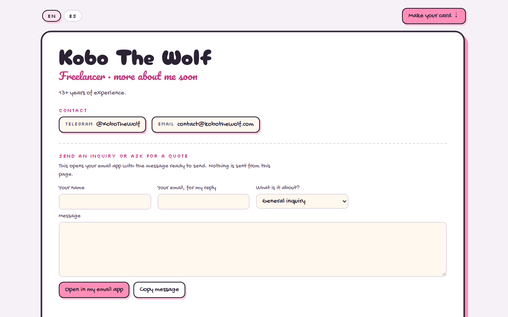
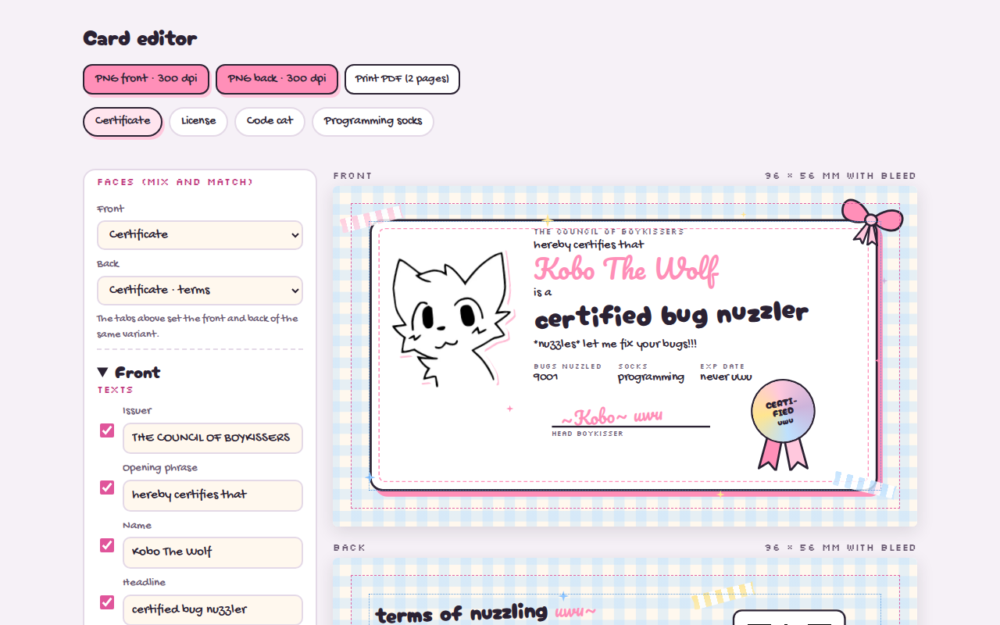

# kobothewolf.com

My site and a live demo of my freelance work: a short profile and the **KOBO.EXE card editor**. You can design and export print-ready business cards (90 × 50 mm with 3 mm bleed) in the boykisser-uwu style, in Spanish or English: a 300 dpi PNG per face and a 2-page print PDF, all made in your browser.

**Live:** https://kobothewolf.com

What's live and what changed is in [CHANGELOG.md](CHANGELOG.md) and the [releases](https://github.com/Solenasth/kobothewolf.com/releases). The last milestone before v1.0.0 (M7: accessibility, the Open Graph image and this README, and a few page features) is in progress.

## Screenshots




## How it works
- **Everything runs in your browser.** Your texts, your drawing (turned into a sticker in a Web Worker) and your exports never leave it. The page loads nothing from other sites, which its Content Security Policy enforces.
- **Cards are data.** Each style and its variants are HTML, CSS and JSON under [`styles/`](styles/); adding a variant needs no code ([how](docs/agregar-variante.md)).
- **Exports:** html-to-image renders each face to a 1134 × 661 PNG marked 300 dpi, and jsPDF puts both on 96 × 56 mm pages. For print shops that want vector text, a command-line tool prints a saved card with real, selectable text.

## How this is built
This repo is a showcase of the process as much as the product.
- **Spec first:** the approved [requirements](docs/REQUIREMENTS.md) and [design](docs/DESIGN.md) come before any code. The [original inputs](docs/origin/) are kept for history.
- **Decisions on record:** [docs/decisions/](docs/decisions/).
- **Issue → PR → release:** every change is traceable to an issue and its requirement IDs, lands through a reviewed PR with signed, conventional commits, and ships in a milestone release. See [CONTRIBUTING.md](CONTRIBUTING.md).
- **Tested in three browsers:** unit tests, end-to-end tests in Chromium, Firefox and WebKit, screenshots compared with the original prototype, and print checks on every export (QR codes, fonts, glyphs).
- **AI-assisted, policy-driven:** the engineering rules live in [policies/](policies/) and [CLAUDE.md](CLAUDE.md).

## Stack
TypeScript · Vite · Preact · html-to-image · jsPDF · Playwright (Chromium, Firefox, WebKit) · vitest · release-please · GitHub Actions → GitHub Pages.

## Run and test locally
Requires the Node version in [`.nvmrc`](.nvmrc).

```sh
npm ci                  # install exactly what the lockfile pins
npx playwright install  # once: the browsers for the end-to-end tests
npm run dev             # dev server
npm test                # unit tests
npm run test:e2e        # end-to-end tests in Chromium, Firefox and WebKit
npm run build           # production build in dist/
```

More commands and the rules for changes are in [CONTRIBUTING.md](CONTRIBUTING.md#local-setup).

### Command line
- `npm run kobo -- pdf-vector card.kobo.json`: a print PDF with real text and embedded fonts from a card saved by the editor.
- `npm run exports:render`, then `npm run kobo -- check-exports exports/`: renders every variant's exports and checks them for print (needs poppler).

## Hosting and DNS
GitHub Pages, deployed by [`deploy.yml`](.github/workflows/deploy.yml) after CI passes on `main`. The custom domain is set in **Settings → Pages** (Actions deploys ignore a `CNAME` file) and verified at the account level against takeovers.

| Host | Type | Value |
|---|---|---|
| `kobothewolf.com` | `A` | `185.199.108.153`, `185.199.109.153`, `185.199.110.153`, `185.199.111.153` |
| `kobothewolf.com` | `AAAA` | `2606:50c0:8000::153`, `2606:50c0:8001::153`, `2606:50c0:8002::153`, `2606:50c0:8003::153` |
| `www.kobothewolf.com` | `CNAME` | `solenasth.github.io` |
| `_github-pages-challenge-solenasth.kobothewolf.com` | `TXT` | account-level domain verification code |

No other `A`, `AAAA`, `ALIAS` or `CNAME` records exist on these hosts. HTTPS is enforced, and `www` redirects to the apex.

## License
Code: MIT (see `LICENSE`). Fonts: OFL, each license next to its file. Meme-template art is credited on the cards and in `CREDITS.md`; rights stay with their holders.
